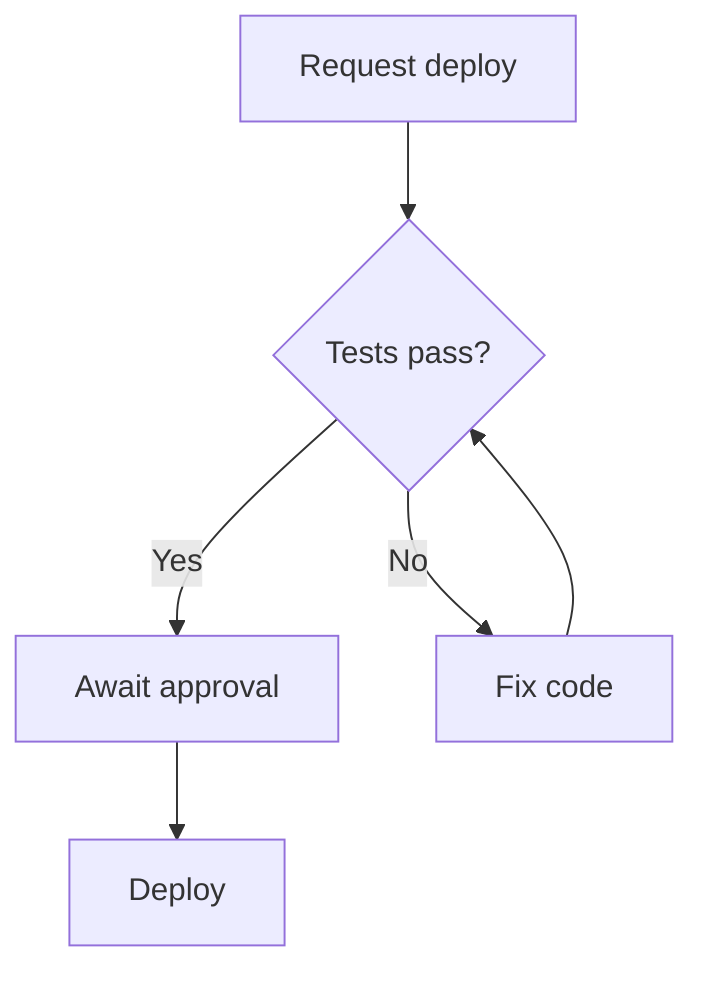

import Image from "next/image";

export const metadata = {
  title: "Archify — install an AI skill and build interactive diagrams from descriptions and code",
  description:
    "A practical Archify guide covering prerequisites, installation for Claude Code, Cursor and Codex, beginner prompts, repository diagrams, validation, HTML sharing and troubleshooting.",
  date: "2026-10-12T10:00",
  tags: ["AI Agent", "Developer Tools", "Architecture", "Diagram"],
  readingMinutes: 12,
};

A service list rarely explains a system on its own. Readers need to see where a request starts, who checks access, where data goes and what happens when something fails. **[Archify](https://www.skills.sh/tt-a1i/archify/archify)** by `tt-a1i` helps a coding agent turn those descriptions into diagrams readers can explore in a browser.

This guide covers installation, a first prompt, repository analysis, revisions and delivery checks. Prompts are original examples for this article. The technical instructions were checked against upstream documentation and Archify package **3.0.1** on **October 12, 2026**; future releases may change the workflow.

## What Archify does

The skill combines agent instructions with a Node.js renderer. The agent interprets your request and authors typed JSON; the renderer turns that source into HTML containing SVG. Keep the JSON for revisions and use the HTML for reading and sharing. Static diagrams are the default; request motion explicitly when needed. See the [Archify skill contract](https://github.com/tt-a1i/archify/blob/main/archify/SKILL.md).

## A real example: the Ads Optimizer workflow

These Archify screenshots explain **Ads Optimizer** through lanes for scheduling and queues, account evaluation, Supabase storage, Meta Graph API and LINE, and the web interface where users act on recommendations.

Follow `pg_cron` → `Seed` → `Evaluate handler` → rules and detectors → recommendations → recommendation cards → `apply / dismiss / revert`. The main path sits alongside automatic pause and notification branches. Colors distinguish node responsibilities, while `SRC` badges identify source references attached to the original diagram. The example's labels are in Thai.

<figure className="article-figure">
  <a
    href="/images/knowledge/archify/ads-optimizer-light.png"
    target="_blank"
    rel="noopener noreferrer"
    data-cursor="OPEN"
  >
    <Image
      src="/images/knowledge/archify/ads-optimizer-light.png"
      alt="Ads Optimizer workflow in five lanes, from pg_cron through evaluation and recommendations to Meta actions, with notification branches, shown in the light theme"
      width={2048}
      height={1320}
      sizes="(max-width: 899px) 100vw, 736px"
    />
  </a>
  <figcaption>Light theme — click to open the full-size PNG and read the detailed labels.</figcaption>
</figure>

<figure className="article-figure">
  <a
    href="/images/knowledge/archify/ads-optimizer-dark.png"
    target="_blank"
    rel="noopener noreferrer"
    data-cursor="OPEN"
  >
    <Image
      src="/images/knowledge/archify/ads-optimizer-dark.png"
      alt="The same Ads Optimizer workflow in the dark theme, with distinct colors for frontend, backend, storage, automatic gates and external services"
      width={2048}
      height={1320}
      sizes="(max-width: 899px) 100vw, 736px"
    />
  </a>
  <figcaption>Dark theme — the same structure and relationships as the light-theme screenshot.</figcaption>
</figure>

These are screenshots of the same HTML diagram in two themes. Node search, source inspection and route exploration require opening the original interactive HTML; the images here illustrate the output you can create.

## Choose the diagram that answers your question

- **Architecture (`architecture`)** maps components and boundaries: what makes up this system?
- **Workflow (`workflow`)** explains steps, responsibilities and branches: how does this approval or deployment process run?
- **Sequence (`sequence`)** follows calls and returns: what happens during this request?
- **Data Flow (`dataflow`)** maps sources, transformations and stores: where does this data go?
- **Lifecycle (`lifecycle`)** explains states and transitions: how does this order or release change status?

Use Architecture for a component overview and Sequence for the order of an API interaction. The [Type router](https://github.com/tt-a1i/archify/blob/main/archify/SKILL.md#type-router) links to schemas and examples for each mode.

## Prepare your environment

Check your tools in the terminal where the coding agent runs:

```bash
node --version
npm --version
git --version
```

Use **Node.js 22.20.0 or newer** for the `npx skills` installation route in this guide. Published `skills` CLI 1.7.2 requires that version, while Archify's renderer only requires Node.js 18. These are separate requirements. Sources: [published skills package](https://registry.npmjs.org/skills/latest) and [Archify package.json](https://github.com/tt-a1i/archify/blob/main/archify/package.json).

If Node is missing, install it from [nodejs.org](https://nodejs.org/) and reopen the terminal. Have a working agent such as Claude Code, Cursor, Codex CLI or OpenCode, plus network access to download the CLI and repository.

The skill's rendering tools need no `npm install` inside its package. Full `finalize` acceptance also requires Chrome or Chromium that the execution environment can launch, because it checks the generated HTML in a real browser. See [Automated browser evidence](https://github.com/tt-a1i/archify/blob/main/archify/references/delivery-contract.md#automated-browser-evidence).

## Install the skill

### Project installation

Enter your project directory, then run the command shown on skills.sh:

```bash
npx skills add https://github.com/tt-a1i/archify --skill archify
```

Review any `npx` package download prompt, then choose the target agent and installation method. Without `--global`, the installation belongs to the current project.

To select the agent directly, use the command matching your setup:

```bash
# Claude Code
npx skills add tt-a1i/archify --skill archify --agent claude-code

# Cursor
npx skills add tt-a1i/archify --skill archify --agent cursor

# Codex CLI
npx skills add tt-a1i/archify --skill archify --agent codex
```

`--skill` selects Archify; `--agent` selects the destination. The syntax is documented in the [skills CLI guide](https://www.skills.sh/docs/cli).

### Global installation and verification

Add `--global` to make the skill available across projects for your user. For example:

```bash
npx skills add tt-a1i/archify --skill archify --agent claude-code --global

npx skills list
npx skills list --global
```

Check for `archify` in the intended scope. Typical project locations include `.claude/skills/archify/` for Claude Code and `.agents/skills/archify/` for Codex. Verify the actual destination reported by the installer; see [Installation options](https://github.com/tt-a1i/archify#installation-options).

The CLI also accepts `--copy` instead of symlinks and `--yes` to skip confirmation prompts. Start interactively when you want to inspect the destination. These options are documented in [skills installation options](https://github.com/vercel-labs/skills#options).

Open a fresh agent session in the intended project and mention Archify explicitly in your request. For more background, read [the skills.sh introduction](/en/knowledge/skills-sh).

## Create your first diagram

Start with a small system whose behavior you can verify. This example assumes the API owns authentication, cache access and database queries:

```text
Use Archify to create a sequence diagram for GET /profile.

1. Browser sends a request with a JWT to API.
2. API verifies the JWT; on failure, return 401 and stop.
3. On success, API reads the profile from Redis.
4. On a cache hit, API returns the cached profile to Browser.
5. On a cache miss, API queries PostgreSQL and fills Redis.
6. API returns 200 with the profile to Browser.

Separate success and failure paths. Keep product names unchanged.
Do not enable animation. Keep the JSON source and HTML output.
Run finalize using the skill workflow, then report the absolute HTML
path, gate results and visual-review status.
```

This specifies actors, ordering, conditions and deliverables. In particular, it keeps the database query conditional on a cache miss and makes the API its caller. Change the facts before using this prompt for a different system. The [Authoring defaults](https://github.com/tt-a1i/archify/blob/main/archify/references/authoring-defaults.md) explain why conditions and responsibilities must survive diagram generation.

## Diagram a real repository

Open the agent in the repository and ask about a connected behavior:

```text
Read this repository and use Archify to create an architecture diagram
of opening the profile page, from Browser to the data store.

Trace the relevant entry point, auth, services and actual reads/writes.
Show external dependencies and trust boundaries only with evidence.
Attach inspected files and line ranges to important components.
Record the referenced commit and state unresolved questions.

Do not invent services from dependency names or edit application code.
Keep JSON and HTML, then run the skill's delivery checks.
```

Repository-backed authoring records repository identity and a commit, then attaches inspected `sources`. A dependency name alone does not prove a runtime service or call. Mention uncommitted changes: evidence is checked against committed bytes at the pinned revision, so working-tree edits cannot be presented as proof for `HEAD`. See [Repository authoring](https://github.com/tt-a1i/archify/blob/main/archify/references/repository-authoring.md).

## Understand the files and delivery checks

Unless you specify another destination, each request gets a new working-directory folder. An illustrative result looks like:

```text
.archify/
  sequence-profile-request-20261012-103000/
    candidate.json
    profile-request.html
```

Actual names depend on type, slug and start time. Receipts add more files. Repairs reuse that request's folder. See [the skill's output convention](https://github.com/tt-a1i/archify/blob/main/archify/SKILL.md).

The current handoff command has this form. **Replace every placeholder with an actual path or type; do not paste angle brackets into your shell.**

```text
node <path-to-archify>/bin/archify.mjs finalize <type> <candidate.json> <output.html> --quality showcase --json
```

`finalize` combines candidate validation, delivery, strict artifact checking and automated browser checking. Repository-backed work also needs `--repo-root`. Read the exit code and summary receipt: an HTML file may exist even when a later gate fails. Automated browser acceptance is separate from someone inspecting the image; `visualReview: "not-requested"` does not claim visual review. See [Delivery contract](https://github.com/tt-a1i/archify/blob/main/archify/references/delivery-contract.md#validate-and-deliver).

## Revise through conversation

Open the HTML, then ask for one focused change:

```text
Update the JSON source to add a PostgreSQL timeout path where API
returns 503. Preserve the cache-hit behavior and keep labels readable.
Run finalize again. Use a fresh evidence directory when earlier
browser evidence already exists for the output.
```

Or ask for clearer supporting copy:

```text
Move long supporting explanations into cards while keeping conditions
on the affected paths. Preserve endpoint and product names.
```

Revise JSON and regenerate HTML together. Direct HTML edits can disappear when the old JSON is rendered again. Follow [the repair contract](https://github.com/tt-a1i/archify/blob/main/archify/references/delivery-contract.md#failed-finalize-and-candidate-repair) when checks fail or evidence already exists.

## Explore and share

Recipients can open the standalone HTML without installing Archify. External source links still need a network connection. See [the standalone output description](https://github.com/tt-a1i/archify#download-it-open-it-explore-it).

- Press `?` for Diagram Guide and `/` to find a node.
- Focus a node and use `Upstream` or `Downstream` to explore authored relationships.
- Use `PATH` or `R` to probe a directed route between endpoints.
- Press `T` to switch theme and `E` for Export.

Exports include PNG, JPEG, WebP and SVG; trace-enabled diagrams can export WebM. Reach and routes describe the authored graph, not observed production behavior or verified change impact. See [Viewer Runtime](https://github.com/tt-a1i/archify/blob/main/archify/references/viewer-runtime.md).

Thai labels and descriptions can be authored directly. The built-in viewer UI supports English and Simplified Chinese; other UI languages require `meta.translations`. Setting `meta.locale: "th"` alone does not translate the whole viewer. See [Language consistency](https://github.com/tt-a1i/archify/blob/main/archify/references/authoring-contract.md#language-consistency).

## Start from existing Mermaid

Paste the Mermaid source into the agent with a conversion request. For example:

```text
Use Archify to turn the following Mermaid into a workflow diagram.
Preserve conditions and arrow directions. Keep it static.
Keep JSON and HTML and run the skill's delivery checks.
```



This is input for the agent, rather than an already generated Archify artifact. The agent interprets Mermaid and authors fresh JSON: flowcharts map to Workflow or Architecture, sequence diagrams to Sequence, and state diagrams to Lifecycle. Review meaning after conversion. See [Mermaid input](https://github.com/tt-a1i/archify/blob/main/archify/SKILL.md#mermaid-input).

## Optional: try the renderer directly

Cloning for this experiment does not install the agent skill. In a test directory without an existing `archify` folder, run these Bash/zsh commands:

```bash
git clone https://github.com/tt-a1i/archify.git
cd archify/archify

node bin/archify.mjs doctor
node bin/archify.mjs demo demo-output
node bin/archify.mjs guide "Show an API request with a Redis cache miss" --json

node bin/archify.mjs finalize sequence \
  examples/cache-miss-request.sequence.json \
  demo-output/cache-miss.html --quality showcase --json
```

Read the receipt and open `demo-output/cache-miss.html`. CLI output can differ from the JSON's `meta.output`, but that authored field must remain a valid relative path. Sources: [CLI implementation](https://github.com/tt-a1i/archify/blob/main/archify/bin/archify.mjs) and [the bundled sequence example](https://github.com/tt-a1i/archify/blob/main/archify/examples/cache-miss-request.sequence.json).

For a session that watches JSON changes:

```bash
node bin/archify.mjs preview sequence \
  examples/cache-miss-request.sequence.json \
  demo-output/cache-miss-preview.html --quality showcase
```

Preview runs on `127.0.0.1`, keeps the last verified output if a new candidate fails, and stops with `Ctrl+C`. See [live preview](https://github.com/tt-a1i/archify#how-it-works).

## Troubleshooting and maintenance

- **Missing Node or `EBADENGINE`**: use a Node version meeting the installer's requirement, reopen the terminal and check its version.
- **The agent cannot find Archify**: verify project/global scope, selected agent and current project, then start a fresh session mentioning the skill.
- **Missing `bin/archify.mjs`**: use the installed file's absolute path, or enter `archify/archify` for the clone example.
- **Schema or layout failure**: have the agent repair the JSON using the diagnostics, then rerun `finalize`.
- **Skipped or failed browser gate**: check browser availability and execution permissions; distinguish passed artifact gates from missing browser evidence.
- **Incorrect system behavior**: check actual call sites and conditions. Artifact validation does not establish semantic truth for your system.

To manage the installation:

```bash
npx skills list
npx skills update archify
npx skills remove archify
```

Review scope choices and affected skills. For a global removal use `npx skills remove archify --global`. See [skills management commands](https://github.com/vercel-labs/skills#other-commands).

Archify can show update reminders during delivery; it does not install updates automatically. Prefix a Bash/zsh command with `ARCHIFY_UPDATE_CHECK_DISABLED=1` to disable its update check. From the cloned package directory, for example:

```bash
ARCHIFY_UPDATE_CHECK_DISABLED=1 node bin/archify.mjs finalize sequence \
  examples/cache-miss-request.sequence.json \
  demo-output/cache-miss-offline-check.html --quality showcase --json
```

This affects Archify's checker, not downloads by `npx`. See [update-check details](https://github.com/tt-a1i/archify#quick-start).

### Further references

- [Archify on skills.sh](https://www.skills.sh/tt-a1i/archify/archify)
- [tt-a1i/archify repository](https://github.com/tt-a1i/archify)
- [Authoring contract](https://github.com/tt-a1i/archify/blob/main/archify/references/authoring-contract.md)
- [skills CLI documentation](https://www.skills.sh/docs/cli)
