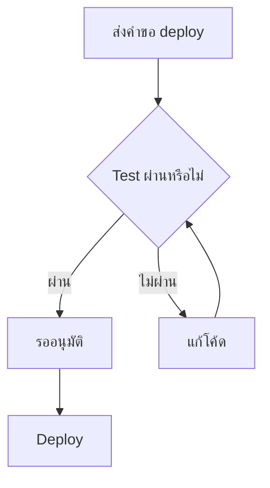

import Image from "next/image";

export const metadata = {
  title: "Archify — ติดตั้งและใช้ AI agent สร้าง diagram แบบ interactive จากคำอธิบายและโค้ด",
  description:
    "คู่มือ Archify ตั้งแต่เตรียม Node.js ติดตั้ง skill ใน Claude Code, Cursor และ Codex ไปจนถึงเขียน prompt สร้าง architecture, workflow และ sequence diagram ตรวจผล และแชร์ไฟล์ HTML",
  date: "2026-10-12T10:00",
  tags: ["AI Agent", "Developer Tools", "Architecture", "Diagram"],
  readingMinutes: 15,
};

เวลาจะอธิบายระบบให้เพื่อนร่วมทีมฟัง รายชื่อ service อย่างเดียวมักไม่พอ เราต้องเห็นว่า request เริ่มที่ไหน ใครตรวจสิทธิ์ ข้อมูลผ่านอะไร และเมื่อเกิดข้อผิดพลาดระบบไปต่ออย่างไร **[Archify](https://www.skills.sh/tt-a1i/archify/archify)** ของ `tt-a1i` ช่วยให้ AI agent เปลี่ยนคำอธิบายเหล่านี้เป็น diagram ที่เปิดสำรวจใน browser ได้

บทความนี้พาเริ่มจากการติดตั้ง skill แล้วสร้างภาพแรกด้วย prompt ตามด้วยการอ่าน repository จริง การปรับภาพ และการตรวจผลก่อนแชร์ ตัวอย่าง prompt เป็นตัวอย่างที่เขียนขึ้นสำหรับคู่มือนี้ ตรวจข้อมูลกับเอกสารต้นทางและ Archify package เวอร์ชัน **3.0.1** เมื่อวันที่ **12 ตุลาคม 2026** คำสั่งและความสามารถอาจเปลี่ยนในรุ่นถัดไป

## Archify คืออะไร และทำงานอย่างไร

Archify มีทั้ง `SKILL.md` ที่สอน agent ว่าควรทำงานอย่างไร และเครื่องมือ Node.js ที่รับข้อมูล diagram เป็น JSON แล้วสร้าง HTML พร้อม SVG อยู่ภายใน ผู้ใช้บอกความต้องการเป็นภาษาธรรมชาติ ส่วน agent รับผิดชอบแปลงความหมายเป็นโครงสร้างและจัดวางภาพ

แนวคิดของ workflow คือ **คำอธิบายหรือโค้ด → JSON → สร้างและตรวจ HTML → เปิดสำรวจและปรับต่อ** JSON จึงเป็นต้นฉบับที่ควรเก็บไว้ ส่วน HTML เป็นไฟล์สำหรับอ่านและแชร์ เอกสารหลักระบุว่าภาพเริ่มต้นเป็นแบบ static; motion เปิดเมื่อขอโดยชัดเจน อ่านรายละเอียดได้ใน [SKILL.md ของ Archify](https://github.com/tt-a1i/archify/blob/main/archify/SKILL.md)

## ตัวอย่างภาพจริง: workflow ของ Ads Optimizer

ภาพด้านล่างเป็นตัวอย่างที่สร้างด้วย Archify สำหรับอธิบาย **Ads Optimizer** โดยแบ่ง workflow เป็นแถวตามหน้าที่ ตั้งแต่การตั้งเวลาและคิว การประเมินบัญชีโฆษณา การเก็บข้อเสนอใน Supabase การเชื่อมต่อ Meta Graph API และ LINE ไปจนถึงหน้าเว็บที่ผู้ใช้เลือกดำเนินการกับข้อเสนอ

ลองไล่เส้นทางจาก `pg_cron` → `Seed` → `Evaluate handler` → กฎและ detector → ใบข้อเสนอ → การ์ดข้อเสนอ → `apply / dismiss / revert` จะเห็นว่าแผนภาพวางเส้นทางหลักไว้ร่วมกับแขนงพักอัตโนมัติและแจ้งเตือน สีช่วยแยกบทบาทของแต่ละ node และป้าย `SRC` แสดงว่ามีแหล่งอ้างอิงประกอบใน diagram ต้นฉบับ

<figure className="article-figure">
  <a
    href="/images/knowledge/archify/ads-optimizer-light.png"
    target="_blank"
    rel="noopener noreferrer"
    data-cursor="OPEN"
  >
    <Image
      src="/images/knowledge/archify/ads-optimizer-light.png"
      alt="Workflow ของ Ads Optimizer แบ่งเป็นห้าแถว แสดงเส้นทางจาก pg_cron ผ่านการประเมินและข้อเสนอไปยัง API ที่ดำเนินการกับ Meta พร้อมแขนงแจ้งเตือน ในธีมสว่าง"
      width={2048}
      height={1320}
      sizes="(max-width: 899px) 100vw, 736px"
    />
  </a>
  <figcaption>ธีมสว่าง — คลิกภาพเพื่อเปิด PNG ขนาดเต็มและอ่าน label รายละเอียด</figcaption>
</figure>

<figure className="article-figure">
  <a
    href="/images/knowledge/archify/ads-optimizer-dark.png"
    target="_blank"
    rel="noopener noreferrer"
    data-cursor="OPEN"
  >
    <Image
      src="/images/knowledge/archify/ads-optimizer-dark.png"
      alt="Workflow เดียวกันของ Ads Optimizer ในธีมมืด แยกสีหน้าเว็บ backend ฐานข้อมูล ด่านอัตโนมัติและบริการภายนอก พร้อมลูกศรแสดงขั้นตอนและแขนงการทำงาน"
      width={2048}
      height={1320}
      sizes="(max-width: 899px) 100vw, 736px"
    />
  </a>
  <figcaption>ธีมมืด — ใช้โครงสร้างและความสัมพันธ์เดียวกับภาพธีมสว่าง</figcaption>
</figure>

ทั้งสองภาพเป็น screenshot ของ HTML เดียวกันในคนละธีม ส่วนการค้นหา node การกดดู source และการสำรวจเส้นทางต้องเปิดไฟล์ HTML ของ diagram จึงจะใช้งานได้ ภาพนิ่งในบทความนี้ช่วยให้เห็นรูปแบบผลลัพธ์ก่อนเริ่มสร้างภาพของตัวเอง

## เลือก diagram ให้ตรงคำถาม

Archify มี 5 โหมดหลัก เลือกจากสิ่งที่อยากให้ผู้อ่านเข้าใจ

- **Architecture (`architecture`)**: ระบบประกอบด้วยอะไร เช่น frontend, API, database และขอบเขตความรับผิดชอบ เหมาะกับภาพรวมของระบบ
- **Workflow (`workflow`)**: งานเดินผ่านขั้นตอนและผู้รับผิดชอบอย่างไร เช่น CI/CD ตั้งแต่ตรวจโค้ดจนอนุมัติ deploy พร้อมทางออกเมื่อไม่ผ่าน
- **Sequence (`sequence`)**: ใครเรียกใครตามลำดับ เช่น request ตรวจ JWT อ่าน cache และ query database เมื่อ cache miss
- **Data Flow (`dataflow`)**: ข้อมูลเคลื่อนจากไหน ผ่านการแปลงอะไร และเก็บที่ไหน เช่น event → queue → ETL → warehouse
- **Lifecycle (`lifecycle`)**: สถานะเปลี่ยนด้วยเหตุการณ์อะไร เช่น order จาก pending ไป paid, shipped หรือ cancelled

ถ้าคำถามคือ “มี service อะไรบ้าง” ให้เริ่มที่ Architecture แต่ถ้าคือ “request นี้เกิดอะไรขึ้นทีละขั้น” Sequence จะอธิบายได้ตรงกว่า ดูตัวอย่างทั้งห้าแบบใน [Type router](https://github.com/tt-a1i/archify/blob/main/archify/SKILL.md#type-router)

## เตรียมเครื่องก่อนติดตั้ง

เปิด terminal ของเครื่องที่ใช้ coding agent แล้วตรวจเครื่องมือพื้นฐาน

```bash
node --version
npm --version
git --version
```

สำหรับคำสั่ง `npx skills` ในคู่มือนี้ ให้ใช้ **Node.js 22.20.0 ขึ้นไป** ตาม `engines` ของ `skills` CLI เวอร์ชัน 1.7.2 ที่เผยแพร่บน npm ณ วันที่ตรวจข้อมูล ตัว renderer ของ Archify เองกำหนดขั้นต่ำเพียง Node.js 18 จึงควรตรวจ requirement ของทั้งสองส่วน ไม่ใช้ขั้นต่ำของ renderer เป็นเงื่อนไขติดตั้ง CLI ดู [แพ็กเกจ skills บน npm registry](https://registry.npmjs.org/skills/latest) และ [package.json ของ Archify](https://github.com/tt-a1i/archify/blob/main/archify/package.json)

ถ้ายังไม่มี Node.js ให้ติดตั้งจาก [nodejs.org](https://nodejs.org/) แล้วเปิด terminal ใหม่จนคำสั่งข้างต้นทำงานได้ ต้องมีการเชื่อมต่อสำหรับดาวน์โหลด CLI และ repository และมี coding agent ที่ใช้งานได้อยู่แล้ว เช่น Claude Code, Cursor, Codex CLI หรือ OpenCode

การสร้างและตรวจ artifact พื้นฐานใช้เครื่องมือที่มากับ skill ได้โดยไม่ต้องรัน `npm install` ภายในแพ็กเกจ ส่วนการตรวจผ่าน `finalize` ให้ครบทุก gate ต้องมี **Chrome หรือ Chromium ที่ execution environment เรียกใช้ได้** เพราะมีการเปิด browser อัตโนมัติเพื่อตรวจ HTML ไม่ใช่แค่มี browser บนเครื่องคนที่รับไฟล์ อ่านเงื่อนไขใน [Automated browser evidence](https://github.com/tt-a1i/archify/blob/main/archify/references/delivery-contract.md#automated-browser-evidence)

## ติดตั้ง Archify ผ่าน skills CLI

### 1. ติดตั้งเฉพาะโปรเจกต์

เข้าโฟลเดอร์โปรเจกต์ก่อน เช่น `cd my-project` แล้วรันคำสั่งจากหน้ารายละเอียดบน skills.sh

```bash
npx skills add https://github.com/tt-a1i/archify --skill archify
```

หาก `npx` ถามว่าจะดาวน์โหลดแพ็กเกจ `skills` หรือไม่ ให้ตรวจชื่อแล้วดำเนินการ จากนั้น CLI จะให้เลือก agent และวิธีวางไฟล์ตามตัวเลือกที่มีบนเครื่อง การไม่ใส่ `--global` หมายถึงติดตั้งระดับโปรเจกต์ เหมาะเมื่ออยากให้ skill อยู่กับงานหรือทีมนี้โดยเฉพาะ

ถ้ารู้ว่าจะใช้ agent ไหน ระบุชื่อได้ตรง ๆ โดยเลือกคำสั่งที่ตรงกับเครื่องมือของคุณ

```bash
# Claude Code
npx skills add tt-a1i/archify --skill archify --agent claude-code

# Cursor
npx skills add tt-a1i/archify --skill archify --agent cursor

# Codex CLI
npx skills add tt-a1i/archify --skill archify --agent codex
```

`--skill archify` เลือก skill นี้จาก repository ส่วน `--agent` กำหนดเครื่องมือปลายทาง วิธีติดตั้งและ flag อ้างอิงจาก [เอกสาร skills CLI](https://www.skills.sh/docs/cli) และ [README ของ skills](https://github.com/vercel-labs/skills#options)

### 2. ติดตั้งให้ใช้ข้ามโปรเจกต์

เพิ่ม `--global` เมื่ออยากให้ agent ของผู้ใช้คนนี้ใช้ skill ได้ในหลายโปรเจกต์ ตัวอย่างสำหรับ Claude Code

```bash
npx skills add tt-a1i/archify --skill archify --agent claude-code --global
```

เปลี่ยนชื่อ agent ได้ตามตัวอย่างก่อนหน้า CLI มีตัวเลือก `--copy` เพื่อคัดลอกไฟล์แทน symlink และ `--yes` เพื่อข้ามคำถามยืนยัน เริ่มต้นด้วยคำสั่งแบบ interactive จะช่วยให้เห็นปลายทางก่อนติดตั้ง

### 3. ตรวจว่าติดตั้งใน scope ที่ตั้งใจ

```bash
# ตรวจระดับโปรเจกต์
npx skills list

# ตรวจระดับผู้ใช้
npx skills list --global
```

มองหาชื่อ `archify` แล้วตรวจ agent และตำแหน่งที่ CLI รายงาน ตัวอย่างตำแหน่งที่ agent อ่านได้คือ `.claude/skills/archify/` สำหรับ Claude Code และ `.agents/skills/archify/` สำหรับ Codex ในระดับโปรเจกต์; ระดับ global ใช้โฟลเดอร์ใต้ home ตาม agent รายละเอียดอยู่ใน [Installation options](https://github.com/tt-a1i/archify#installation-options)

จากนั้นเปิด session ใหม่ของ agent ในโปรเจกต์ที่ต้องการ แล้วเริ่ม prompt ด้วยคำว่า “ใช้ Archify” ถ้า agent ยังไม่เห็น skill ให้ตรวจ scope และ path ก่อนสร้างภาพ หากต้องการอ่านภาพรวมการจัดการ skill เพิ่มเติม ดูบทความ [รู้จัก skills.sh](/th/knowledge/skills-sh)

## สร้าง diagram แรกจากคำอธิบาย

เริ่มจากระบบเล็กที่เราตรวจความถูกต้องเองได้ ตัวอย่างนี้สมมติว่า API เป็นผู้ตรวจ JWT อ่าน Redis และเรียก PostgreSQL เฉพาะเมื่อ cache miss

```text
ใช้ Archify สร้าง sequence diagram อธิบายการเรียก GET /profile

1. Browser ส่ง request พร้อม JWT ไป API
2. API ตรวจ JWT ถ้าไม่ผ่านให้ตอบ 401 และจบ request
3. ถ้าผ่าน API อ่าน profile จาก Redis
4. ถ้า cache hit ให้ API ตอบข้อมูลกลับ Browser
5. ถ้า cache miss ให้ API query PostgreSQL แล้วเขียนผลกลับ Redis
6. API ตอบ 200 พร้อม profile กลับ Browser

ใช้ label ภาษาไทย แต่คงชื่อ Browser, API, JWT, Redis และ PostgreSQL
ไว้ตามเดิม แยกเส้นทางสำเร็จและข้อผิดพลาดให้เห็นชัด ไม่เปิด animation
เก็บ JSON ต้นฉบับกับ HTML และรัน finalize ตาม workflow ของ skill
แจ้ง absolute path ของ HTML พร้อมผลตรวจและสถานะ visual review
```

prompt นี้บอกทั้ง **ชนิดภาพ ผู้กระทำ ลำดับ เงื่อนไข และสิ่งที่ต้องส่งมอบ** จึงลดช่องว่างที่ agent ต้องเดา โดยเฉพาะการแยกว่า API เป็นคน query database และ cache miss เป็นเงื่อนไขของการ query ไม่ใช่ Redis เรียก PostgreSQL เอง

ข้อกำหนดเรื่องการใช้ภาษาและการรักษาเงื่อนไขของความสัมพันธ์อยู่ใน [Authoring defaults](https://github.com/tt-a1i/archify/blob/main/archify/references/authoring-defaults.md) ตัวอย่างข้างต้นเป็นระบบสมมติ ถ้าระบบจริงของคุณทำงานต่างออกไป ให้เปลี่ยนข้อเท็จจริงก่อนสั่งสร้าง

## อ่าน repository จริงแล้วสร้างภาพ

เปิด agent ใน repository ที่ต้องการอธิบาย แล้วระบุขอบเขตเป็นพฤติกรรมที่ติดตามได้ เช่น request ของหน้า profile แทนการสั่งกว้าง ๆ ว่า “วาดทั้งโปรเจกต์”

```text
อ่าน repository นี้ แล้วใช้ Archify สร้าง architecture diagram
ที่อธิบายเส้นทางเปิดหน้า profile ตั้งแต่ Browser ถึงแหล่งเก็บข้อมูล

ตาม entry point, auth, service และจุดอ่านหรือเขียนข้อมูลที่เกี่ยวข้อง
แสดง external dependency และ trust boundary เฉพาะที่มีหลักฐาน
ผูก component สำคัญกับไฟล์และช่วงบรรทัดที่ตรวจแล้ว
ระบุ commit ที่ใช้อ้างอิง และบอกสิ่งที่ยังยืนยันไม่ได้

อย่าเพิ่ม service จากการเดาชื่อ dependency
ไม่แก้ application code เก็บ JSON และ HTML แล้วตรวจตาม skill
```

workflow ของ repository ต้องบันทึกที่มาและ commit แล้วอ้าง `sources` จากไฟล์ที่ตรวจจริง การมี dependency ใน `package.json` ไม่ได้พิสูจน์ว่ามี service นั้นอยู่ในเส้นทาง request และความสัมพันธ์ในภาพต้องตรงกับผู้เรียกและผู้รับจริง อ่านแนวทางใน [Repository authoring](https://github.com/tt-a1i/archify/blob/main/archify/references/repository-authoring.md)

หากมีไฟล์ที่แก้แต่ยังไม่ commit ให้แจ้ง agent ด้วย หลักฐานในโหมดนี้ตรวจจากข้อมูลที่ commit ไว้ ณ revision ที่ระบุ จึงไม่ควรนำโค้ดที่ยังไม่ commit มาอ้างว่าเป็นหลักฐานของ `HEAD` การแยกสิ่งที่ตรวจได้กับสมมติฐานทำให้ภาพใช้คุยเรื่องระบบได้โดยไม่สร้างความมั่นใจเกินหลักฐาน

## ไฟล์ผลลัพธ์อยู่ที่ไหน และตรวจอะไรบ้าง

ถ้าไม่ได้กำหนดที่เก็บเอง skill ให้สร้างโฟลเดอร์ใหม่ต่อคำขอใน working directory เช่นโครงสร้างสมมตินี้

```text
.archify/
  sequence-profile-request-20261012-103000/
    candidate.json
    profile-request.html
```

ชื่อจริงขึ้นกับชนิดภาพ slug และเวลาที่เริ่มงาน มีไฟล์ receipt เพิ่มเติมตามขั้นตอนตรวจด้วย เก็บ JSON ไว้แก้ต่อ และให้ agent ใช้โฟลเดอร์เดิมสำหรับการซ่อมงานคำขอนั้น รายละเอียดของตำแหน่งเริ่มต้นอยู่ใน [SKILL.md](https://github.com/tt-a1i/archify/blob/main/archify/SKILL.md)

คำสั่งส่งมอบหลักของ skill ปัจจุบันมีรูปแบบดังนี้ **นี่เป็นแม่แบบ ให้แทน path ทุกส่วนด้วยตำแหน่งจริง** อย่าคัดลอกวงเล็บแหลมไปรันตรง ๆ

```text
node <path-to-archify>/bin/archify.mjs finalize <type> <candidate.json> <output.html> --quality showcase --json
```

`finalize` รวมการตรวจ candidate, การสร้างและส่งมอบ artifact, strict artifact check และ automated browser check ถ้าอ้าง repository ต้องส่ง `--repo-root` ด้วย การที่มี HTML ถูกสร้างขึ้นแล้วไม่ได้แปลว่าทุก gate ผ่าน ให้ดู exit code และ summary receipt ก่อนใช้คำว่าเสร็จครบ

การตรวจด้วย browser อัตโนมัติยังต่างจาก **visual review** ที่มีคนหรือ agent ดูภาพจริง สถานะ `visualReview: "not-requested"` จึงไม่ได้แปลว่าตรวจความสวยงามแล้ว อ่านสัญญาการส่งมอบใน [Delivery contract](https://github.com/tt-a1i/archify/blob/main/archify/references/delivery-contract.md#validate-and-deliver)

## ปรับ diagram ผ่านบทสนทนา

เปิด HTML ดูก่อน แล้วขอปรับเป็นประเด็น ตัวอย่างคำขอต่อจากภาพ profile

```text
ใน JSON ต้นฉบับ ให้เพิ่มกรณี PostgreSQL timeout แล้ว API ตอบ 503
คงเส้นทาง cache hit เดิมไว้ จัดระยะให้ label อ่านง่าย
ตรวจ finalize ใหม่ และใช้โฟลเดอร์ evidence ใหม่เมื่อมีหลักฐานรอบเก่าอยู่แล้ว
```

หรือปรับภาษาและรายละเอียดให้เหมาะกับผู้อ่าน

```text
เปลี่ยนคำอธิบายที่เป็นภาษาอังกฤษให้เป็นไทย
คงชื่อ endpoint และ product ตามเดิม
ย้ายคำอธิบายประกอบที่ยาวไปไว้ใน cards โดยรักษาเงื่อนไขบนเส้นทาง
```

ควรให้ agent แก้ JSON แล้วสร้างและตรวจ HTML ใหม่ เพื่อให้ต้นฉบับตรงกับภาพที่ส่งต่อ ถ้าขอให้แก้ HTML โดยตรงแล้วกลับมา render จาก JSON เดิม การแก้เหล่านั้นอาจหายไป แนวทางซ่อมและหลักฐานรอบใหม่อยู่ใน [Failed finalize and candidate repair](https://github.com/tt-a1i/archify/blob/main/archify/references/delivery-contract.md#failed-finalize-and-candidate-repair)

## เปิดสำรวจและแชร์ภาพ

ดาวน์โหลดหรือเปิดไฟล์ HTML ใน browser ได้ ผู้รับไม่ต้องติดตั้ง Archify เพื่อดูไฟล์ ลิงก์ออกไปยัง repository หรือเว็บไซต์อื่นยังต้องใช้อินเทอร์เน็ต ดูรูปแบบไฟล์ใน [README](https://github.com/tt-a1i/archify#download-it-open-it-explore-it)

ใน viewer ลองเริ่มจากปุ่มเหล่านี้

- กด `?` เปิด Diagram Guide เพื่อดูเครื่องมือของภาพนั้น
- กด `/` ค้นหา node แล้ว focus เพื่ออ่านรายละเอียด
- เลือก node แล้วใช้ `Upstream` หรือ `Downstream` ดูความสัมพันธ์ที่เขียนไว้
- ใช้ `PATH` หรือ `R` เลือกต้นทางและปลายทางเพื่อตรวจ directed route
- กด `T` สลับ theme และ `E` เปิด Export

Export รองรับภาพ PNG, JPEG, WebP และ SVG; WebM ใช้กับภาพที่เปิด trace motion ความสัมพันธ์ที่ viewer แสดงมาจาก diagram ที่เขียนไว้ ไม่ได้สำรวจ production หรือยืนยันผลกระทบจริงของการเปลี่ยน service ดูขอบเขตและ export ใน [Viewer Runtime](https://github.com/tt-a1i/archify/blob/main/archify/references/viewer-runtime.md)

สำหรับภาษาไทย เราขอให้ agent เขียน label และคำอธิบายเป็นไทยได้ แต่ UI ของ viewer มีภาษาอังกฤษและจีนแบบ built-in ภาษาอื่นต้องมี `meta.translations` เพิ่ม การใส่ `meta.locale: "th"` เพียงอย่างเดียวจึงไม่ได้แปล UI ทั้งหมด ดู [Language consistency](https://github.com/tt-a1i/archify/blob/main/archify/references/authoring-contract.md#language-consistency)

## ใช้ diagram เดิมที่เขียนด้วย Mermaid

ถ้ามี Mermaid อยู่แล้ว ให้ส่งโค้ดให้ agent พร้อมคำขอแปลง เช่นตัวอย่าง workflow ที่เขียนขึ้นนี้

```text
ใช้ Archify แปลง Mermaid ด้านล่างเป็น workflow diagram
รักษาเงื่อนไขและทิศทางเดิม ใช้ label ภาษาไทย ไม่เปิด animation
เก็บ JSON กับ HTML และตรวจตาม workflow ของ skill
```



code block นี้เป็น input สำหรับส่งให้ agent ไม่ใช่ภาพ Archify ที่สร้างแล้ว agent จะอ่านความหมายของ Mermaid และเขียน JSON ใหม่ โหมดที่รองรับเป็นแนวทางคือ `flowchart`/`graph` ไป Workflow หรือ Architecture, `sequenceDiagram` ไป Sequence และ `stateDiagram` ไป Lifecycle ขั้นตอนนี้อาศัย agent ตีความ จึงต้องตรวจเงื่อนไขและลูกศรหลังแปลง ดู [Mermaid input](https://github.com/tt-a1i/archify/blob/main/archify/SKILL.md#mermaid-input)

## ทดลอง CLI โดยไม่ผ่าน agent

ส่วนนี้เป็นทางเลือกสำหรับคนที่อยากตรวจ renderer แยกจาก agent **การ clone เพื่อทดลอง CLI ไม่ได้ติดตั้ง skill ให้ agent** ตัวอย่างใช้ shell แบบ Bash หรือ zsh ในโฟลเดอร์ทดลองที่ยังไม่มี `archify`

```bash
git clone https://github.com/tt-a1i/archify.git
cd archify/archify

# ตรวจสภาพแวดล้อมและสร้างชุด demo
node bin/archify.mjs doctor
node bin/archify.mjs demo demo-output

# ช่วยเลือกชนิด diagram จากสถานการณ์
node bin/archify.mjs guide "Show an API request with a Redis cache miss" --json

# ใช้ JSON ตัวอย่างที่มากับ repository แล้วตรวจและสร้าง HTML
node bin/archify.mjs finalize sequence \
  examples/cache-miss-request.sequence.json \
  demo-output/cache-miss.html --quality showcase --json
```

เปิด `demo-output/cache-miss.html` หลังอ่านผลตรวจ คำสั่ง CLI รับ output path แยกจาก `meta.output` ใน JSON ได้ แต่ `meta.output` ยังต้องเป็น path แบบ relative ที่ถูกต้อง ตัวอย่างชุดนี้อ้างอิง [CLI source](https://github.com/tt-a1i/archify/blob/main/archify/bin/archify.mjs) และ [Cache-miss sequence example](https://github.com/tt-a1i/archify/blob/main/archify/examples/cache-miss-request.sequence.json)

ถ้าต้องการ preview ที่เปลี่ยนตาม JSON ใช้คำสั่งนี้แทนการส่งมอบหนึ่งครั้ง

```bash
node bin/archify.mjs preview sequence \
  examples/cache-miss-request.sequence.json \
  demo-output/cache-miss-preview.html --quality showcase
```

preview เปิด session บน `127.0.0.1` และดูการเปลี่ยนไฟล์ต้นฉบับ หาก candidate ใหม่ไม่ผ่าน ระบบคงภาพที่ผ่านล่าสุดไว้ กด `Ctrl+C` เพื่อหยุด ตาม [Live preview documentation](https://github.com/tt-a1i/archify#how-it-works)

## แก้ปัญหาที่เจอบ่อย

- **ขึ้น `node: command not found` หรือ `EBADENGINE`**: ติดตั้งหรือสลับ Node.js ให้ผ่าน requirement ของ installer แล้วเปิด terminal ใหม่ ตรวจ `node --version` อีกครั้ง
- **ติดตั้งแล้ว agent ไม่ใช้ Archify**: ตรวจชื่อ skill ด้วย `skills list` ทั้ง project/global ตรวจ agent ที่เลือกและโฟลเดอร์โปรเจกต์ จากนั้นเริ่ม session ใหม่พร้อมระบุ “ใช้ Archify”
- **ขึ้นว่าไม่พบ `bin/archify.mjs`**: คำสั่งตัวอย่างใน skill สมมติ path ของแพ็กเกจ ให้ใช้ absolute path ของไฟล์ที่ติดตั้งจริง หรือเข้า `archify/archify` หากทดลองด้วย clone
- **schema หรือ layout ไม่ผ่าน**: ส่ง diagnostics ให้ agent แก้ JSON ตาม field และตำแหน่งที่รายงาน แล้วรัน `finalize` ใหม่ อย่าข้าม gate เพียงเพื่อให้ได้ HTML
- **browser gate ถูก skip หรือ fail**: ตรวจว่า environment มี Chrome/Chromium และอนุญาตให้รัน หากรันไม่ได้ ให้รายงาน gate ที่ผ่านกับ browser evidence ที่ขาดแยกกัน
- **ภาพไม่ตรงระบบจริง**: เปรียบเทียบกับ call site และเงื่อนไขในโค้ด แก้ข้อเท็จจริงก่อนปรับสีหรือ layout เพราะการตรวจ artifact ไม่ได้พิสูจน์ความหมายของระบบแทนเรา

## ดูแล skill หลังเริ่มใช้

ใช้ CLI ตรวจและจัดการ skill เมื่อจำเป็น

```bash
npx skills list
npx skills update archify
npx skills remove archify
```

คำสั่งจัดการอาจให้เลือก scope; ระบุ global ตอนถอนด้วย `npx skills remove archify --global` หากติดตั้งไว้ระดับผู้ใช้ ตรวจรายการที่ CLI แสดงก่อนดำเนินการ ดู [คำสั่งจัดการ skills](https://github.com/vercel-labs/skills#other-commands)

Archify มีการแจ้งเตือนอัปเดตระหว่างส่งมอบ แต่ไม่ได้ติดตั้งรุ่นใหม่อัตโนมัติ หากต้องการปิดการเชื่อมต่อของ update checker ให้ใส่ `ARCHIFY_UPDATE_CHECK_DISABLED=1` หน้าคำสั่งที่ทดลองบน Bash/zsh เช่นคำสั่งนี้จากโฟลเดอร์แพ็กเกจที่ clone ไว้

```bash
ARCHIFY_UPDATE_CHECK_DISABLED=1 node bin/archify.mjs finalize sequence \
  examples/cache-miss-request.sequence.json \
  demo-output/cache-miss-offline-check.html --quality showcase --json
```

ตัวเลือกนี้ควบคุม checker ของ Archify ไม่ได้ทำให้ขั้นตอนดาวน์โหลดด้วย `npx` ทำงาน offline อ่าน [Update-check details](https://github.com/tt-a1i/archify#quick-start)

### แหล่งอ้างอิงเพิ่มเติม

- [Archify บน skills.sh และคำสั่งติดตั้ง](https://www.skills.sh/tt-a1i/archify/archify)
- [Repository ของ tt-a1i/archify](https://github.com/tt-a1i/archify)
- [ข้อกำหนดการเขียนและภาษา](https://github.com/tt-a1i/archify/blob/main/archify/references/authoring-contract.md)
- [เอกสาร skills CLI](https://www.skills.sh/docs/cli)
